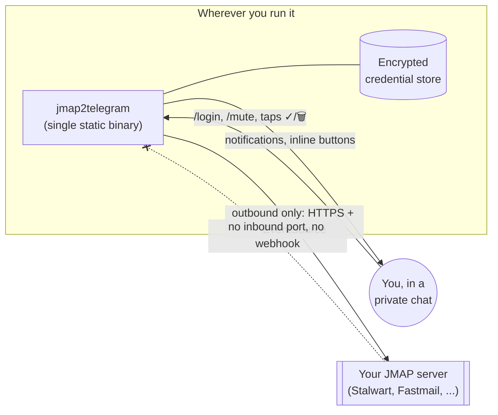

# jmap2telegram

[](https://github.com/delta-whiplash/jmap2telegram/actions/workflows/ci.yml)
[](https://github.com/delta-whiplash/jmap2telegram/actions/workflows/security-audit.yml)
[](https://github.com/delta-whiplash/jmap2telegram/releases/latest)
[](LICENSE)
[](https://github.com/delta-whiplash/jmap2telegram/pkgs/container/jmap2telegram)
[](https://github.com/delta-whiplash/jmap2telegram/pkgs/container/charts%2Fjmap2telegram)

**Self-hosted [GmailBot](https://t.me/GmailBot) alternative for Telegram: your [JMAP](https://jmap.io/) mailbox - [Stalwart Mail Server](https://stalw.art), Fastmail, or any RFC 8620 provider - as native Telegram notifications.** Read, mark read, archive, and delete your mail without leaving the chat.

Because JMAP providers authenticate with a bearer token rather than an
OAuth redirect flow, the bot needs no public callback URL, no webhook, and
no inbound network exposure at all - it only makes outbound connections to
Telegram and to your own JMAP server. Your mail credentials never transit
a third party: the bot runs wherever you run it, next to (or on) your own
mail server.



## Why I built this

I love GmailBot's concept: mail triage happens where I already live - a
Telegram chat - with one-tap archive/delete and instant previews. What I
don't love is what it implies: handing a third-party bot read access to my
entire mailbox, through someone else's infrastructure, under someone
else's data policy.

I self-host my mail on a [Stalwart Mail Server](https://stalw.art), and
Stalwart speaks [JMAP](https://jmap.io) natively - JMAP is the protocol
Stalwart was designed around, not an add-on. So instead of choosing
between "the bot I like" and "the privacy I want", I built the bot I
wanted: one binary, my server, my data, the same GmailBot-style chat
experience. Stalwart users get the deepest integration - delegated/shared
mailboxes (`/shared`), instant push via JMAP `EventSource`, and
autodiscovery with zero manual endpoints - see
[Running with Stalwart](#running-with-stalwart).

If you run Fastmail or any other JMAP-compliant provider, everything
works the same way; the privacy pitch just changes from *your* server to
*your provider's* server - either way, no bot vendor in the middle.

## Contents

- [Why I built this](#why-i-built-this)
- [Why JMAP instead of Gmail](#why-jmap-instead-of-gmail)
- [Running with Stalwart](#running-with-stalwart)
- [Security & privacy by design](#security--privacy-by-design)
- [Quickstart (Docker)](#quickstart-docker)
- [Commands](#commands)
- [What gets notified](#what-gets-notified)
- [Shared mailboxes](#shared-mailboxes)
- [Extra personal accounts](#extra-personal-accounts)
- [Languages](#languages)
- [Environment variables](#environment-variables)
- [Observability](#observability)
- [Kubernetes (Helm, OCI)](#kubernetes-helm-oci)
- [Building from source](#building-from-source)
- [Releases](#releases)
- [Limitations (v1 scope)](#limitations-v1-scope)
- [License](#license)

## Why JMAP instead of Gmail

- **No OAuth app to register.** A bearer token from your provider's
  security settings is all you need.
- **Push, not polling.** JMAP's `EventSource` mechanism notifies the bot
  the moment new mail arrives (RFC 8620 §7.3).
- **Provider-agnostic.** Works with any JMAP server that supports RFC 8620
  autodiscovery (`/.well-known/jmap`) - Fastmail, Stalwart, and others.
- **Respects Telegram's rate limits.** Every outbound Telegram request goes
  through `teloxide`'s throttle adaptor at Telegram's own documented
  defaults (1 msg/s per chat, 30 msg/s overall) with automatic retry on
  `RetryAfter`, so a burst of new mail (a mailing list flood, a newsletter)
  can't get individual notifications dropped or delayed out of order.
- **Tells you when a connection actually breaks.** A revoked token or an
  unreachable server doesn't just fail silently in a log somewhere: after
  about a minute of being unable to reconnect, the bot sends a message
  telling you which account and why, and another once it's back.

## Running with Stalwart

Stalwart is the deployment this bot was designed around. No special
configuration is needed on either side:

1. **Create an API token.** In the Stalwart web admin, open your personal
   settings and create an API token with JMAP access. This token is what
   you'll paste into `/login` - not your account password.
2. **Point the bot at your server.** In Telegram:

   ```
   /login https://mail.example.org <your-token>
   ```

   The bot discovers the session endpoint itself via
   `/.well-known/jmap` (RFC 8620 autodiscovery), which Stalwart serves
   out of the box - no manual endpoint to configure.

3. **Self-hosting Stalwart on a private/LAN address?** The bot's SSRF
   guard refuses private/loopback addresses by default. Since it's your
   own server, opt in explicitly with `ALLOW_PRIVATE_JMAP_HOSTS=1` -
   see [Environment variables](#environment-variables).

What you get on Stalwart specifically:

- **Instant push.** New mail arrives via JMAP `EventSource` (RFC 8620
  §7.3) - no polling delay, exactly the immediacy GmailBot users expect.
- **Delegated/shared mailboxes.** Stalwart can grant a token access to
  other mailboxes (team inboxes, shared addresses). `/shared` lists
  them live and toggles notifications per mailbox - see
  [Shared mailboxes](#shared-mailboxes).
- **Same server, same data.** Run the bot next to Stalwart (Docker
  Compose or the Helm chart) and your mail content never leaves the
  machine it's already on.

## Security & privacy by design

- **Two environment variables, full stop.** `TELEGRAM_BOT_TOKEN` and
  `AUTHORIZED_CHAT_IDS` are the only configuration the deployment needs.
  Everything else (your JMAP server + token) is entered live, per user,
  through the bot's chat - never through config files or CI secrets.
  (`DATA_DIR`, `ALLOW_PRIVATE_JMAP_HOSTS`, `TIMEZONE`, and `LOG_LEVEL` are
  optional overrides for advanced setups - see below.)
- **SSRF-safe by default.** `/login`'s `server_url` is only ever used if
  it resolves to a public address; private/loopback/link-local/metadata
  addresses are refused unless you explicitly opt in with
  `ALLOW_PRIVATE_JMAP_HOSTS=1`. This matters because `AUTHORIZED_CHAT_IDS`
  can list several mutually-untrusted users on one deployment.
- **Private chats only.** The bot ignores anything that isn't a 1:1 DM, so
  a group chat id in `AUTHORIZED_CHAT_IDS` can't silently hand every
  member of that group control over one shared mailbox.
- **Hard allowlist.** Only the Telegram chat ids listed in
  `AUTHORIZED_CHAT_IDS` can interact with the bot at all; everyone else is
  refused before anything is read, stored, or logged.
- **Encrypted at rest.** Credentials are stored AES-256-GCM encrypted,
  with a random master key generated on first boot and kept at 0600 on
  disk. No email content is ever written to disk - full message bodies
  are fetched on demand and only held in memory long enough to relay them
  to Telegram.
- **The `/login` message self-destructs.** The message carrying your JMAP
  token is deleted from the chat immediately after the bot reads it.
- **Right to erasure.** `/logout` permanently and immediately wipes that
  chat's stored credentials and stops all notifications - no soft delete,
  no retention window.
- **No third-party data flows.** The bot talks to exactly two services:
  the Telegram Bot API and your own JMAP server, both over TLS
  (`rustls`, no OpenSSL in the dependency tree).
- **Minimal attack surface.** No inbound ports, no webhook server, no
  database - a single static binary long-polling Telegram outbound. The
  container image is `scratch`: that one statically-linked (musl) binary
  and the CA roots, nothing else - no shell, no libc, no OS packages, so
  an image scanner has nothing to report.

See [`SECURITY.md`](SECURITY.md) for the full threat model and how to
report a vulnerability.

## Quickstart (Docker)

```bash
docker run -d \
  --name jmap2telegram \
  -e TELEGRAM_BOT_TOKEN="123456:ABC-your-bot-token" \
  -e AUTHORIZED_CHAT_IDS="111111111,222222222" \
  -v jmap2telegram-data:/data \
  ghcr.io/delta-whiplash/jmap2telegram:latest
```

Or with Compose:

```bash
cp .env.example .env   # fill in TELEGRAM_BOT_TOKEN and AUTHORIZED_CHAT_IDS
docker compose up -d
```

Then, in Telegram, from one of the authorized chats. Don't know your chat
id yet? Jump to [Finding your Telegram chat id](#finding-your-telegram-chat-id)
below before continuing:

```
/start
/login <server_url> <token>
```

- `server_url` is your provider's JMAP server root (e.g. Fastmail:
  `https://jmap.fastmail.com`) - the bot discovers the actual session
  endpoint itself via `/.well-known/jmap`.
- `token` is an API (Bearer) token from your provider's security
  settings - not your account password.

The `/login` message is deleted automatically right after the bot reads
it, so the token doesn't linger in the chat history.

### Finding your Telegram chat id

`AUTHORIZED_CHAT_IDS` is the bot's hard allowlist, and a fresh deployment
starts with a chicken-and-egg problem: you need your numeric Telegram
chat id to configure the allowlist, but Telegram's UI never shows that id
anywhere - it is not your @username - and the bot can't tell you either,
because until the id is in the allowlist it refuses to talk to you. Two
ways out:

1. **Let the bot tell you (no third party).** Start it with a placeholder
   in the allowlist - `AUTHORIZED_CHAT_IDS=0` is enough, the variable
   just must not be empty or the bot refuses to boot - open a private
   chat with your bot, and send anything (`/start` works). The bot will
   answer with an "access denied" message, but it also logs the refused
   chat id at `WARN` level, visible with the default `LOG_LEVEL=info`:

   ```
   2026-10-05T14:23:45.123+02:00  WARN jmap2telegram::bot: unauthorized access attempt chat_id=111111111
   ```

   Read it with `docker logs -f jmap2telegram` (under the Helm chart:
   `kubectl logs -f <pod>`), put that number in `AUTHORIZED_CHAT_IDS`,
   and restart the bot. Your id never leaves your machine and Telegram's.

2. **Ask @userinfobot.** Message
   [@userinfobot](https://t.me/userinfobot) in Telegram and it replies
   with your numeric chat id, among other details. Convenient, but it's
   an unrelated third-party bot - use method 1 if you'd rather not send
   it anything at all.

### Commands

| Command        | Effect                                                                 |
|----------------|--------------------------------------------------------------------------|
| `/start`       | Onboarding, or current status if already connected                     |
| `/login`       | `/login <server_url> <token>` - connect a JMAP account                 |
| `/status`      | Show the connected account and watcher health                          |
| `/shared`      | Toggle notifications for shared/delegated JMAP accounts (alias `/partages`) |
| `/accounts`    | `/accounts <server_url> <token>` - connect an extra, independent JMAP account; no argument lists connected accounts (alias `/comptes`) |
| `/mute`        | `/mute <term>` - filter future notifications by sender/keyword; no argument lists active filters |
| `/unmute`      | Remove a filter added with `/mute`                                     |
| `/search`      | `/search <text>` - full-text search of the connected mailbox (alias `/rechercher`) |
| `/lang`        | `/lang <en\|fr>` - choose the bot's language (alias `/langue`)         |
| `/logout`      | Erase stored credentials immediately (GDPR right to erasure)           |
| `/help`        | List commands                                                          |

Command names are English throughout (they're also the ids the client's
autocomplete keys off); the original French names still work as hidden
aliases, so nothing typed before the rename breaks. The command list is
registered with Telegram itself in each shipped language, so the "/" menu
autocompletes in French or English to match the app.

Each new-mail notification carries a deliberately small action menu:
`[ 📥 Archive ] [ 🗑 Delete ] [ ⋯ More ]` as it arrives, expanding on
`⋯ More` to the full set - **📖 Read all**, **✅ Read** (becoming an inert
✔️ once read), **🚫 Spam**, and **⌃ Less** to collapse again. Every label,
and the notification text itself, follows the reader's language. The
sender is a tappable `mailto:` link, the preview renders as a native
quoted block, and any attachment is named with its size. Every triage
action (Archive/Spam/Delete) leaves a 30-second **↩️ Undo** button that
restores the message to exactly the mailboxes it was in before - an
in-memory, non-persisted safety net for an accidental tap, not a second
trash bin.

### What gets notified

The bot reports **what arrived**, not what the mailbox contains. Every
message the JMAP account gains is classified first, and only the ones
that are genuinely news reach the chat:

| Message | Notified? | Why |
|---------|-----------|-----|
| A mail that arrived | yes | the case the bot exists for - read or not, a mailbox is an inbox: everything that lands in it was received, and you want to know about it even if another client got to it first |
| A draft being written | no | it is a message *you* are composing, not one you received - and a webmail client saves a new draft on every auto-save, so this used to produce one notification per keystroke-batch |
| A copy of a mail you sent | no | it is filed in the Sent folder, or sent from your own address |

The classification reads the server's own truth - the mailbox roles
(`Drafts`, `Sent`, ...), the RFC 8621 `$draft` keyword, and the sender
- so it does not depend on the folder a provider happens to use. A
filing rule that moves your incoming mail out of the Inbox does not
silence it: the filter only removes what you wrote.

`/mute` still applies on top of that, per sender or keyword, and the
sync cursor moves past a skipped message either way - it is never
re-announced later. The
[`jmap2telegram_notifications_skipped_total`](#observability) counter
counts what was filtered and why, so a quiet bot is explainable.

### Shared mailboxes

Some JMAP servers (Stalwart in particular) can grant a token delegated
access to other mailboxes - team/shared inboxes distinct from your own
personal account. `/shared` lists whatever shared accounts your token
currently has access to (fetched live from the server each time, not
cached) with a toggle button per account. Enabling one starts its own
background watcher and notifications for it, labeled with the shared
mailbox's address so you can tell them apart from your own mail; disabling
one stops its watcher and forgets its sync cursor. This is unrelated to
Telegram group chats - the bot still only ever talks in 1:1 DMs (see
[`SECURITY.md`](SECURITY.md)) - it's purely about how many JMAP accounts a
single connected chat follows.

### Extra personal accounts

Unlike `/shared` (delegated access under one token), `/accounts` connects
a second, fully independent JMAP account - its own server and token,
e.g. a work mailbox alongside a personal one. `/accounts <server_url>
<token>` connects one (the message is deleted right after, same as
`/login`); `/accounts` with no argument lists everything connected, with a
disconnect button per extra account. Disconnecting one only forgets that
account - reconnecting means running `/accounts` again with its
credentials.

### Languages

The bot ships English (`en`) and French (`fr`). A chat's language is
resolved in this order:

1. an explicit choice made with `/lang en|fr` (persisted per chat);
2. the Telegram client's own `language_code` when it names a shipped
   language (`fr-FR` selects `fr`) - also persisted at `/login` time;
3. the operator's `BOT_LANGUAGE`;
4. English.

Command descriptions are registered with Telegram per language, so the
"/" menu is localized to each client automatically. Only the bot's own
wording is translated - email content (subjects, senders, bodies) is
never rewritten.

### Environment variables

| Variable                  | Required | Default | Effect                                                                 |
|----------------------------|----------|---------|-------------------------------------------------------------------------|
| `TELEGRAM_BOT_TOKEN`       | yes      | -       | Bearer token from @BotFather                                           |
| `AUTHORIZED_CHAT_IDS`      | yes      | -       | Comma-separated allowlist of Telegram chat ids                        |
| `DATA_DIR`                 | no       | `/data` | Where the encrypted credential store lives                            |
| `ALLOW_PRIVATE_JMAP_HOSTS` | no       | `0`     | Set to `1` to allow `/login` to a private/internal JMAP server (SSRF guard bypass) |
| `TIMEZONE`                 | no       | `UTC`   | IANA zone name (e.g. `Europe/Paris`) for notification and log timestamps |
| `BOT_LANGUAGE`             | no       | `en`    | Default language (`en` or `fr`) for chats that haven't chosen one with `/lang`; an unsupported value refuses to start |
| `HEALTH_ADDR`              | no       | `0.0.0.0:8080` | Address the `/healthz`, `/readyz` and `/metrics` listener binds to |
| `LOG_LEVEL`                | no       | `info`  | `trace`, `debug`, `info`, `warn`, or `error`                           |
| `RUST_LOG`                 | no       | -       | Advanced per-module filter (tracing's `EnvFilter` syntax); overrides `LOG_LEVEL` when set |

## Observability

The listener above also serves a Prometheus `/metrics` endpoint (text
format) on the same address:

```bash
curl -s http://localhost:8080/metrics
```

Alongside the liveness/readiness probes (`/healthz`, `/readyz`), it
exposes process gauges (`process_resident_memory_bytes`,
`jmap2telegram_build_info{version=…}`, `jmap2telegram_start_time_seconds`,
`jmap2telegram_accounts`, `jmap2telegram_pending_undos`), the watcher's
connection/sync gauges (`jmap2telegram_watchers_registered`,
`jmap2telegram_watchers_connected`,
`jmap2telegram_last_activity_age_seconds{watcher=…}`), and counters for
delivered notifications, send errors, triage actions, mark-as-read and
undos. One more counter, `jmap2telegram_notifications_skipped_total{kind=…,reason=…}`,
counts the new messages that were *not* announced - `reason` being one of
`draft`, `sent` or `own` (see
[What gets notified](#what-gets-notified)). Every label is bounded and
bot-generated - no email address, subject or message id ever becomes a
metric label, so cardinality stays flat regardless of traffic.

This is a plain endpoint by design: wiring it into Prometheus (a
`ServiceMonitor`, scrape annotations, a `PodMonitor`, …) is the scraper's
concern, so the Helm chart intentionally ships no scrape template.

## Kubernetes (Helm, OCI)

```bash
helm install jmap2telegram oci://ghcr.io/delta-whiplash/charts/jmap2telegram \
  --version <chart-version> \
  --set telegram.botToken="123456:ABC-your-bot-token" \
  --set telegram.authorizedChatIds="111111111,222222222"
```

For a real deployment, keep the bot token out of your values files with a
pre-existing Secret instead:

```bash
kubectl create secret generic jmap2telegram-token \
  --from-literal=bot-token="123456:ABC-your-bot-token"

helm install jmap2telegram oci://ghcr.io/delta-whiplash/charts/jmap2telegram \
  --version <chart-version> \
  --set telegram.existingSecret=jmap2telegram-token \
  --set telegram.authorizedChatIds="111111111,222222222"
```

See [`charts/jmap2telegram/values.yaml`](charts/jmap2telegram/values.yaml)
for every option (persistence, resources, security context, ...). The
chart intentionally creates no Service/Ingress - the bot only makes
outbound connections - and always runs exactly one replica, since it's a
single stateful long-poller backed by one local encrypted file store.

## Building from source

```bash
cargo build --release
cargo test
```

Requires no system TLS library (rustls throughout). `cargo test` includes
a mock-server integration test of the JMAP session bootstrap in addition
to unit tests for the config, encrypted store, and message formatting.

## Releases

Tagging `vX.Y.Z` and pushing it triggers
[`.github/workflows/release.yml`](.github/workflows/release.yml) - but the
tag itself builds nothing. The image is already built and gated: every
push to `main` runs the full CI suite (fmt, clippy, tests, `cargo audit`,
Docker build, Helm lint, gitleaks, `zizmor`) and, only once every gate is
green, publishes the multi-arch (`amd64`/`arm64`) image under a
commit-addressed tag `sha-<sha>`. Each platform's manifest carries an
attached SLSA provenance and an SPDX SBOM (`provenance: mode=max`,
`sbom: true`), so what a given digest contains, and what built it, are
answerable from the registry alone. Those two are attached but unsigned -
readable, not verifiable - so the same run also signs one: `actions/attest-build-provenance`
records the workflow's OIDC identity against the published index and pushes
the bundle to the registry next to it, which turns the claim into something
anyone can check rather than merely read:

```bash
gh attestation verify oci://ghcr.io/delta-whiplash/jmap2telegram@sha256:<digest> \
  --repo delta-whiplash/jmap2telegram
```

Both digests are printed at the top of every release's notes, because a
digest is the only name for an artifact that cannot be re-pointed later.
The release is then a pure *promotion* of that exact digest, so what ships
is byte-for-byte what CI built and tested:

1. promotes the commit's `sha-<sha>` digest to the release tags on
   `ghcr.io/delta-whiplash/jmap2telegram`: `vX.Y.Z` (the exact release),
   `X.Y`, `X`, and `latest` - the bare `X.Y.Z` form is **not** published,
   so pin pull commands to the `v`-prefixed tag;
2. packages and pushes the Helm chart as an OCI artifact to
   `oci://ghcr.io/delta-whiplash/charts/jmap2telegram`, versioned from the
   same tag;
3. cuts a GitHub Release with autogenerated notes.

Because the release never rebuilds, a tag must point at a commit that
already has a `sha-<sha>` image - i.e. a commit on `main` whose CI passed.
A tag anywhere else fails loudly rather than publishing an untested
build.

Release tags are immutable. A published `vX.Y.Z` is never re-pointed at a
different commit, and its digest is never overwritten: both would change
what someone who already pinned that version gets. Releasing a version
that is already out therefore fails loudly - the fix is a new patch
version, not a moved tag. A manual dispatch that lands on the very same
commit is a no-op, so retrying a failed run stays safe. The comparison is
between *commits*, following the tag object when the ref is annotated, so a
tag cut by hand reads exactly like the lightweight tag the workflow creates
itself.

The chart is held to the same rule, for the same reason. GHCR has no
per-tag protection for OCI artifacts (the ruleset mechanism is a git
feature), so `helm push` would rewrite a published version without
complaining. The chart is therefore compared by *content* rather than by
digest - `helm package` stamps file mtimes into the tarball, so the same
chart packaged twice has two different digests. A published version is
never re-pushed: byte-identical content is skipped, which makes retrying a
half-finished release a no-op instead of a silent rewrite, and content
that differs is refused outright - the fix there is a new version, not an
artifact rewritten under someone who already pinned it.

The tag ruleset cannot cover everything, though: it stops a *published*
tag from being moved, not a tag whose version disagrees with the code it
points at - which is how `v0.6.0` once shipped a 0.5.2 binary. `prep`
therefore refuses a release unless `Cargo.toml`'s version matches the tag,
so the name on the tin is checked against what `cargo build` stamped into
the artifact.

All four of those decisions live in
[`release-guards.sh`](.github/scripts/release-guards.sh), and CI runs them
on every pull request rather than leaving them to the next release:
`release-guards-check` reads both tag kinds and asserts the guard refuses
to move either, runs the image-tag guard against a real published digest,
and puts the chart guard through all three of its outcomes (publish, skip,
refuse). Everything there is read-only; the one guard that *can* write runs
in `DRY_RUN` and the check asserts it created nothing. That is not
decoration: `release.yml` is the one workflow no ordinary CI run executes,
and both bugs found in it so far - an annotated tag read as a moved one,
and a release creation that failed a retry instead of doing nothing - were
found in production, by cutting real releases.

The rule is enforced in two places rather than merely intended: the
workflows above refuse the collision, and a repository ruleset
(`immutable release tags`, targeting `refs/tags/v*`) blocks updates and
deletions outright - so a forced `git push` cannot rewrite a published tag
either. Tag *creation* is deliberately left open: that is how a release is
cut. `main` is protected the same way: a second ruleset requires a pull
request and a green CI run before anything lands on it, so the maintainer's
own commits pass the same gates as anyone else's.

### Keeping the registry tidy

An immutable `sha-<commit>` image per merge would grow without bound, so
[`prune-package-versions.sh`](.github/scripts/prune-package-versions.sh) runs
after every merge and removes two kinds of leftovers:

- **manifests nothing points at.** A multi-arch build pushes its per-arch
  images and their attestations *untagged*, then attaches a tagged index.
  Once that index is pruned or moved on by a re-release, its children are
  stranded. Only manifests unreachable from *any* tag are eligible, so a
  published image is never affected;
- **per-commit `sha-<commit>` images older than 30 days.** The window is a
  duration, not a number of commits: what matters is how long a merge may
  sit unreleased, which is a delay, and twenty commits is a week on a busy
  repository and a year on a quiet one. A released image is ineligible
  twice over - it also carries `vX.Y.Z` / `X.Y` / `X` / `latest` on the
  same version, and its commit carries a tag - and the commit `main` is on
  is kept whatever its age, since that is the one a release would promote.

The same script runs with `DRY_RUN=true` on every pull request - printing
what it *would* delete - so the rules stay exercised rather than merely
trusted; only a push to `main` ever deletes. The one sharp edge left is a
tag pushed on a commit that is neither `main`'s HEAD nor less than thirty
days old: it has no image left to promote, and the release says so instead
of shipping something else.

### Staying current with no one at the wheel

The repo is meant to look after itself between feature work:

- **Dependency updates.** [Renovate](https://github.com/renovatebot/renovate)
  runs from [`renovate.yml`](.github/workflows/renovate.yml) on a schedule,
  driven by [`renovate.json5`](renovate.json5), and opens PRs for Cargo,
  the Docker builder image (`rust:1-slim-bookworm`, digest-pinned; the
  runtime stage is `scratch`, so it has no base image to track), the Rust
  compiler pin in [`rust-toolchain.toml`](rust-toolchain.toml), and GitHub
  Actions - every action pinned to a commit SHA, grouped, and gated by the
  same CI suite as any other PR. It authenticates with its own GitHub App
  (`RENOVATE_APP_ID` + `RENOVATE_APP_PRIVATE_KEY` repository secrets) whose
  repository permissions are exactly `Administration` (read), `Dependabot
  alerts` (read) and read+write on `Checks`, `Commit statuses`, `Contents`,
  `Issues`, `Pull requests` and `Workflows` - the set Renovate documents,
  and the same set the workflow asks the token for, rather than the
  workflow's `GITHUB_TOKEN`: a PR opened with `GITHUB_TOKEN` does not
  trigger workflow runs, so with seven required checks it could never be
  merged. With no secrets configured the workflow skips itself with a
  notice and changes nothing.
- **Auto-merge for routine bumps.** Patch/minor updates merge themselves
  once CI is green (Renovate automerge rules); major bumps are always
  left for manual review.
- **The workflows audit themselves.** `zizmor` runs on every push and pull
  request and fails the build on an unpinned action, a `${{ }}` expansion
  inside a `run:` block, an over-broad token permission, or a
  poisoning-prone cache. It runs online, so its `impostor-commit` audit
  independently re-checks that every pinned SHA really is a commit of the
  repository it claims to come from. The single exemption it carries is
  written down and argued in
  [`.github/zizmor.yml`](.github/zizmor.yml).
- **A pinned compiler on both sides.** Rust is pinned once, in
  `rust-toolchain.toml`: CI resolves it through the runner's rustup and
  the Dockerfile copies it into the build, so the compiler that checks a
  commit is the compiler that builds the shipped binary - they cannot
  drift apart on a base-image bump. `cargo build` runs `--locked` in
  both, so the artifact is built from the lockfile CI validated.
- **Weekly lockfile maintenance.** `Cargo.lock` is refreshed weekly so
  transitive dependency fixes (e.g. RUSTSEC advisables in dependencies of
  dependencies) land without waiting for an upstream release.
- **Standing security watch.**
  [`security-audit.yml`](.github/workflows/security-audit.yml) re-runs
  `cargo audit` every week regardless of whether anything was pushed, so
  a RUSTSEC advisory published against an already-shipped dependency
  still surfaces as a tracking issue instead of going unnoticed until the
  next unrelated change.

In steady state, that means most future updates are exactly two kinds:
routine version bumps (merged automatically) and the occasional security
fix (flagged automatically, fixed by hand when it needs more than a
`cargo update`).

## Limitations (v1 scope)

- Notifications and reading/triage only - no compose/reply/forward from
  Telegram yet (mirrors GmailBot's core loop, not its full feature set).
- One JMAP account per authorized Telegram chat (multi-tenant); there's no
  shared-mailbox-to-many-viewers mode.

## License

[`LICENSE`](LICENSE) - the **Cardinal Code Open1 Attribution License**.
Free to use, modify, sell, and redistribute for any purpose, commercial
or not, subject to a few conditions:

- **Attribution.** Keep a visible credit to **delta-whiplash** as the
  original author and **jmap2telegram** as the original project,
  wherever a user of your distribution would reasonably see it - even if
  you rename or repackage it. The license spells out the exact wording.
- **Naming.** You can fork and rename your own version freely, but you
  can't call your fork "jmap2telegram" in a way that could be mistaken
  for the original project.
- **No implied endorsement.** Crediting the origin doesn't mean claiming
  delta-whiplash endorses or is affiliated with your fork.
- **Automatic termination.** Breaking any of the above ends your license
  automatically (with a 30-day cure window).

Not a standard SPDX license id, so tooling that expects one (e.g. `cargo
package`) is pointed at the file directly via `license-file` in
[`Cargo.toml`](Cargo.toml).
